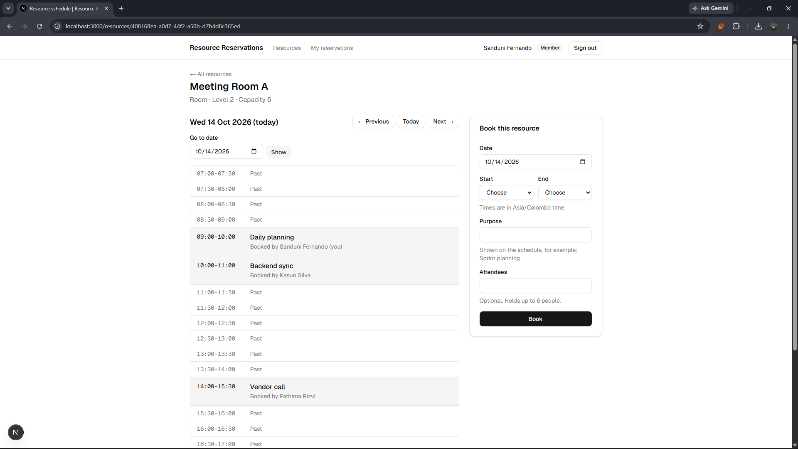
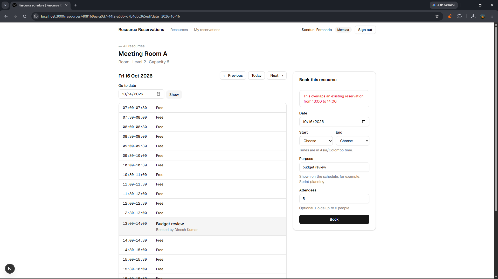
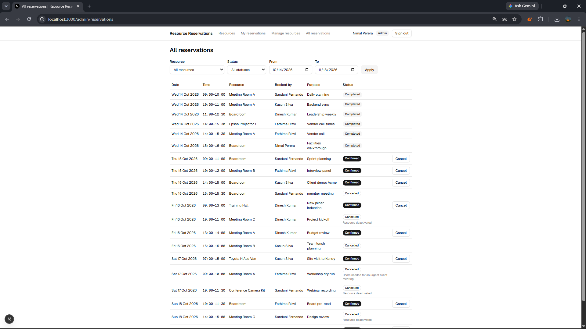
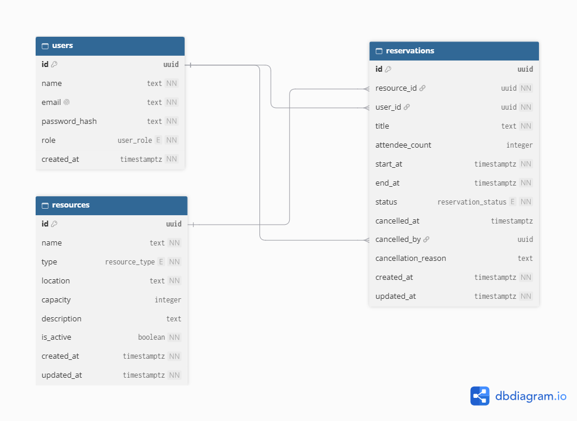

# Resource Reservation Management System

An organization shares meeting rooms, equipment and vehicles between many people and teams, and books them through chat messages and manual records. That leads to double bookings, and nobody can easily tell whether something is free. This application gives everyone one place to see what exists, check when it is available and reserve it. **The database itself guarantees that two confirmed reservations of the same resource can never overlap**, even when two people submit the same slot at the same moment.

Built for the PrimeWave Lab software engineering internship assessment. The scope is deliberately small: a few features, each enforced properly on the server.

## Screenshots

| Day schedule and booking form | A refused conflict | Admin: all reservations |
|---|---|---|
|  |  |  |

## Features

**Every signed-in user (member or admin)**

- Browse active resources, filter by type and search by name
- See a resource's day schedule: who booked each slot and why, with previous/next day and a date picker
- Book a free slot (date, start, end, purpose, optional attendee count); the reservation is confirmed instantly
- See their own reservations grouped as upcoming, past and cancelled, including who cancelled and why
- Edit the time, title or attendee count of an upcoming reservation, or cancel it

**Admins only**

- Create and edit resources (name, type, location, optional capacity, description)
- Deactivate a resource: its upcoming reservations are cancelled in the same operation, after a confirmation that shows how many; reactivate it later
- See every reservation, filtered by resource, status and date range, and cancel any upcoming one with a reason the owner will see

Every rule is enforced on the server: hiding a button is never the only protection.

## Tech stack

| Layer | Choice | Why |
|---|---|---|
| Framework | Next.js 16 (App Router), React 19, TypeScript (strict) | Server Components and Server Actions keep data access on the server without a separate API |
| Database | PostgreSQL 17 | Exclusion constraints and range types make "no overlapping bookings" a database guarantee |
| Data access | Drizzle ORM, drizzle-kit migrations, `pg` | Typed queries close to SQL; plain SQL migration files that can be reviewed |
| Authentication | Auth.js v5 (credentials, JWT session), bcryptjs | Maintained session and CSRF handling; passwords stored as bcrypt hashes |
| Validation | Zod | One schema per input gives both runtime checks and TypeScript types |
| UI | Tailwind CSS, shadcn/ui, sonner | Accessible components without building a design system |
| Time | date-fns, date-fns-tz | Explicit time-zone conversion, independent of the server's own zone |
| Tests | Vitest | Fast unit tests plus integration tests against a real PostgreSQL |

## Getting started

### Prerequisites

- Node.js 20.9 or newer (developed on Node 22)
- Docker Desktop, or any PostgreSQL 14+ (see [Without Docker](#without-docker))

### Setup

```bash
git clone https://github.com/chamindujayasinghe/resource-reservation-system.git
cd resource-reservation-system

# 1. Environment file
cp .env.example .env
#    Generate a secret and paste it as AUTH_SECRET in .env:
node -e "console.log(require('crypto').randomBytes(32).toString('base64'))"

# 2. Dependencies
npm install

# 3. Database (PostgreSQL 17 in Docker, on host port 5433)
docker compose up -d

# 4. Create the tables and load the demo data
npm run setup

# 5. Start the app
npm run dev
```

Open http://localhost:3000 and sign in with one of the demo accounts below.

The container also creates an empty `reservations_test` database, which the integration tests use, so they never touch the demo data. The database credentials in `docker-compose.yml` and `.env.example` are for local development only.

Port **5433** is used instead of 5432 so it does not clash with a PostgreSQL already installed on your machine.

### Without Docker

Create two empty databases (for example `reservations` and `reservations_test`) in PostgreSQL 14 or newer, point `DATABASE_URL` and `DATABASE_URL_TEST` in `.env` at them, then continue from step 4. The database user must be allowed to create the `btree_gist` extension, which database owners can do on PostgreSQL 13 and newer.

### Demo accounts

Every account uses the password **`Password123!`**

| Email | Name | Role |
|---|---|---|
| admin@example.com | Nimal Perera | Admin |
| sanduni@example.com | Sanduni Fernando | Member |
| kasun@example.com | Kasun Silva | Member |
| fathima@example.com | Fathima Rizvi | Member |
| dinesh@example.com | Dinesh Kumar | Member |

The seed's dates are relative to the day it runs, so there are always past, today's and upcoming reservations to look at. It includes a back-to-back pair, cancelled reservations with reasons, and an inactive resource (Meeting Room C). Run `npm run db:reset` at any time to start again from fresh demo data.

## Scripts

| Command | What it does |
|---|---|
| `npm run dev` | Start the development server |
| `npm run build` / `npm start` | Production build / run it |
| `npm run lint` | ESLint |
| `npm run typecheck` | TypeScript, with Next.js route types |
| `npm run format` | Prettier |
| `npm test` | All tests (needs the database container running) |
| `npm run test:unit` / `npm run test:integration` | Only one group |
| `npm run db:up` | Start the database container |
| `npm run db:generate` | Generate a migration after changing `src/server/db/schema.ts` |
| `npm run db:migrate` | Apply pending migrations |
| `npm run db:seed` | Replace all data with the demo data |
| `npm run db:reset` | Empty the database, migrate and seed |
| `npm run setup` | Migrate and seed (first run) |

## How double booking is prevented

The guarantee is a PostgreSQL **exclusion constraint**, in a hand-written migration ([`drizzle/0001_no_overlap_constraint.sql`](drizzle/0001_no_overlap_constraint.sql)):

```sql
CREATE EXTENSION IF NOT EXISTS btree_gist;

ALTER TABLE "reservations"
  ADD CONSTRAINT "reservations_no_overlap"
  EXCLUDE USING gist (
    "resource_id" WITH =,
    tstzrange("start_at", "end_at", '[)') WITH &&
  )
  WHERE ("status" = 'confirmed');
```

It rejects any confirmed reservation whose time range overlaps (`&&`) another confirmed one for the same resource. The `'[)'` bounds include the start and exclude the end, so 09:00–10:00 and 10:00–11:00 can both exist. Cancelled reservations are ignored.

**Why a check in application code is not enough:** two requests can both run "is this slot free?", both see "yes", and both insert. No amount of checking in Node.js closes that gap; only the database sees every write at the moment it happens.

The service still checks first and locks the resource row (`SELECT … FOR UPDATE`), but only to give a helpful message ("This overlaps an existing reservation from 10:00 to 11:00") and to keep a concurrent deactivation consistent. If two requests still collide, the constraint refuses one with SQLSTATE `23P01`, which is mapped to "That time slot was just taken". The same constraint protects edits.

**Proven by tests** against a real database: two separate connections inserting the same range at once (exactly one commits), and 10 parallel bookings of one slot from 10 users, repeated in a loop (exactly 1 succeeds and 1 row exists). The same is tested with partly overlapping ranges, for edits, and for booking while an admin deactivates the resource.

## Architecture

```
Browser
  │  forms and links
  ▼
src/app/        Pages (Server Components): call requireUser()/requireAdmin(), read data, render
src/actions/    Server Actions: thin adapters (current user → Zod parse → one service call → revalidate)
  │
  ▼
src/server/services/   ALL business logic and transactions; re-checks role and ownership every time
  │
  ├──► src/domain/     Pure rules, no I/O: time rules, capacity rule, time-zone conversion, config
  └──► src/server/db/  Drizzle schema and client ──► PostgreSQL (constraints are the final authority)
```

- **Business logic lives in one place**, `src/server/services/`, with the pure rules in `src/domain/`. Pages and actions contain no queries and no rules, so each rule is written once and used by both booking and editing.
- **Services take the acting user and "now" as parameters** and never read cookies. That makes them easy to test and keeps authorization explicit: every service checks role and ownership itself, so a forged request cannot skip a check that only the UI performed.
- **Actions never throw to the browser.** They return `{ ok: true, data }` or `{ ok: false, error }` with a message, per-field errors and the submitted values, so input survives a failed submit. Database errors are mapped by SQLSTATE and constraint name (`src/server/errors.ts`), never by message text, and raw errors never reach the browser.
- **Validation in layers:** browser hints for convenience; Zod for shape; domain rules for time, duration and capacity, checked against the server's clock; the service for state (resource active, still confirmed, not started); and database constraints as the last line.
- **Time:** stored as `timestamptz` (UTC). All conversion goes through `src/domain/time.ts` with the organization's time zone (Asia/Colombo) passed explicitly, so results do not depend on the server's or the viewer's time zone.
- **No middleware and no REST API.** Each page checks access itself, and the UI is the only client.

| Folder | Contents |
|---|---|
| `src/app/` | Pages and layouts; `(app)/` is the signed-in area, with `admin/` inside it |
| `src/actions/` | Server Actions, one file per domain, plus the shared result type |
| `src/server/services/` | Resources, reservations, users, authorization |
| `src/server/auth/` | Auth.js configuration and `getCurrentUser` / `requireUser` / `requireAdmin` |
| `src/domain/` | `config.ts`, `time.ts`, `reservation-rules.ts`, `schedule.ts` |
| `src/validation/` | Zod schemas for forms and URL parameters |
| `drizzle/` | SQL migrations (generated, plus the hand-written constraint) |
| `scripts/` | Seed and reset |
| `tests/unit/`, `tests/integration/` | Vitest suites |

## Data model



Interactive diagram: [dbdiagram.io/d/6acf9326aebfe7a21feb5cb8](https://dbdiagram.io/d/6acf9326aebfe7a21feb5cb8). Source: [`docs/schema.dbml`](docs/schema.dbml).

Three tables: `users`, `resources` and `reservations`. A reservation belongs to one resource and one owner, and records who cancelled it. Every foreign key is `ON DELETE RESTRICT`, because nothing is ever deleted: resources are deactivated and reservations are cancelled, so history stays intact.

Key constraints, all enforced by PostgreSQL:

| Constraint | Guarantees |
|---|---|
| `reservations_no_overlap` | No overlapping confirmed reservations per resource (see above) |
| `reservations_end_after_start` | `end_at > start_at` |
| `reservations_cancellation_consistent` | `cancelled_at` and `cancelled_by` are set if and only if the status is `cancelled` |
| `reservations_title_length` | Title is 3 to 100 characters |
| `resources_name_unique` | Resource names are unique ignoring case (unique index on `lower(name)`) |
| `resources_capacity_positive`, `reservations_attendee_count_positive` | Capacity and attendee count are positive when present |
| `users_email_lowercase` | Emails are stored in lower case, so sign-in is case-insensitive |

Indexes support the common lookups: a resource's reservations by start time, a user's reservations by start time, and all reservations by start time for the admin list.

## Key decisions and trade-offs

- **Instant confirmation, no approval step.** First come, first served is what the brief's problem needs. An approval workflow adds states and screens without making the core guarantee stronger.
- **Exclusive booking.** One reservation holds the whole resource; capacity only checks that a group fits. Several bookings sharing one room is much harder to enforce safely under concurrency and was not asked for.
- **Seeded users, no sign-up.** In a real organization accounts would come from the company directory (SSO), so self-registration and password reset would be effort spent on something that gets replaced.
- **Deactivate instead of delete.** Deleting a resource would destroy its booking history. Deactivating hides it and cancels its upcoming reservations in the same transaction, with a reason the owners can see.
- **One organization time zone.** All times are shown and entered in Asia/Colombo and stored in UTC. A single-site organization does not need per-user zones, and Sri Lanka has no daylight saving.
- **Server Actions instead of a REST API.** The web UI is the only client, so a separate API would only duplicate validation and authorization. Business logic sits in services, so an API could be added later without moving any rules.
- **Admins cancel but never edit someone else's reservation**, so an owner is never silently moved to a different time.

Smaller technical choices are recorded in [`docs/decisions.md`](docs/decisions.md).

## Business rules

The full list (BR1 to BR26) is in [`docs/project-scope.md`](docs/project-scope.md#6-business-rules). In short:

| Area | Rules |
|---|---|
| Time | 30-minute boundaries; 30 minutes to 8 hours; within 07:00–20:00 on one day; not in the past; at most 60 days ahead |
| Conflicts | No overlap with another confirmed reservation of the same resource; back-to-back is allowed; cancelled ones do not count |
| Resources | Only active resources can be booked (checked at the moment of booking); names unique ignoring case; attendee count must not exceed capacity |
| Ownership | Only the owner edits; the owner or an admin cancels, and an admin must give a reason for someone else's; only before the reservation starts |
| History | Nothing is deleted; a cancellation records who, when and why, and is final |

## Testing

```bash
docker compose up -d       # integration tests need the database container
npm test                   # everything
npm run test:unit          # pure rules only, no database
npm run test:integration   # services and constraints against PostgreSQL
```

- **Unit tests** cover every time rule (boundaries, duration, operating hours, past, 60 days ahead), the capacity rule, time-zone conversion and the day schedule, with a fixed clock.
- **Integration tests** run against a separate `reservations_test` database, migrated once and emptied before each test; a guard refuses to empty any database whose name does not end in `_test`. They cover:
  - the exclusion constraint on its own, using raw inserts
  - concurrent bookings, edits and cancellations
  - every service rule
  - admin-only access
  - deactivation, including the booking-versus-deactivation race
  - the mapping of real PostgreSQL errors to user-facing messages

UI components are not unit tested; they were checked by hand against a manual checklist, including phone width.

## Known limitations

- Members are not notified when an admin cancels their reservation; they see the status and reason the next time they open "My reservations".
- Schedules do not update live; another user's booking appears after a refresh or the next action. This is safe, because the database decides, never the screen.
- A reservation in progress cannot be ended early or extended, and no-shows keep their slot.
- One time zone and one set of operating hours for every resource; no holidays.
- The admin reservation list shows at most 100 rows per search, and asks you to narrow the filters when there are more.

## What I would do next

- Email or in-app notifications when a reservation is cancelled by someone else
- An approval workflow for selected resources
- Recurring reservations, with conflict handling across the whole series
- Per-resource operating hours, holidays and maintenance windows
- A week view and a "find a free resource" search
- End-to-end browser tests (for example Playwright) for the main flows
- Deployment, with SSO for accounts

## Use of AI tools

I used Claude Code, an AI coding assistant, while building this project. I wrote the scope and plan, reviewed each change before it was made, and ran the tests myself, and I can explain every decision in the code.

## Links

- [Project scope](docs/project-scope.md): stories, business rules, edge cases, out of scope
- [Project plan](docs/project-plan.md): architecture, data model, transactions, tests, phases
- [Decision log](docs/decisions.md)
- [Database schema (DBML)](docs/schema.dbml)
